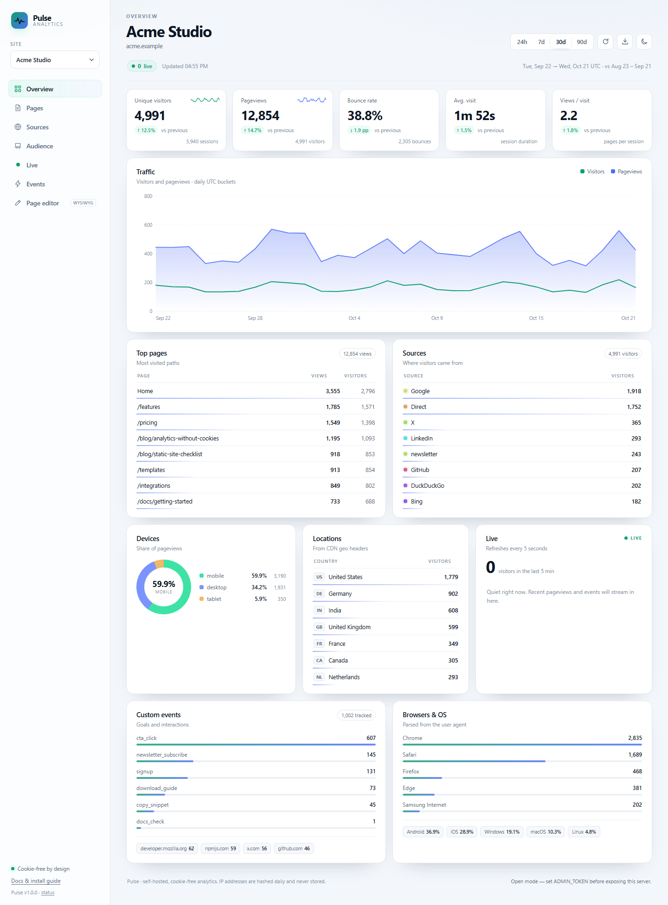
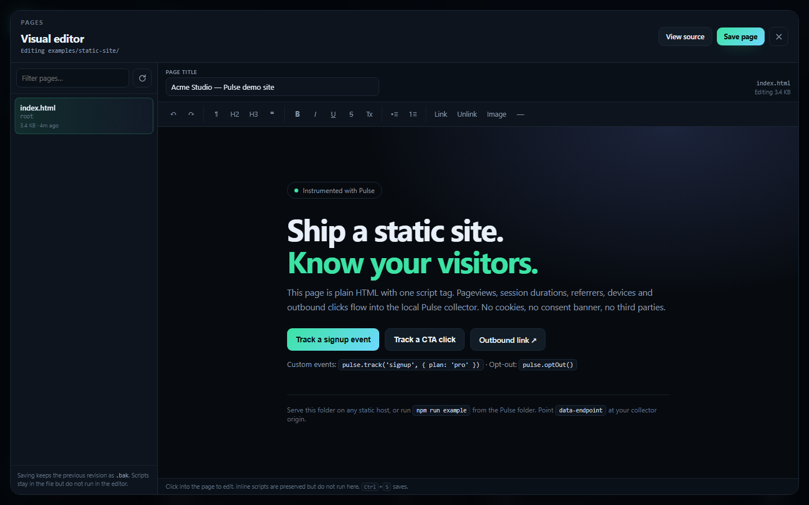

# Pulse

Privacy-first, self-hosted visitor analytics for static HTML sites.

Pulse is a single Node.js process with **zero runtime dependencies**. Add one `<script>` tag to any static site, and get a fast dashboard with visitors, pageviews, sources, devices, locations, sessions, custom events, outbound clicks and a live feed. It also includes a small WYSIWYG **page editor** for the static HTML files on your server. No cookies, no consent banner, no third-party requests.



<p align="center">
  <a href="docs/dashboard-dark.png">Dark theme</a> ·
  <a href="docs/dashboard-mobile.png">Mobile layout</a> ·
  <a href="docs/editor-dark.png">Page editor</a> ·
  <a href="#quick-start">Quick start</a> ·
  <a href="#api">API</a>
</p>

## Why another analytics tool?

- **Static-site native.** One script tag. Works with Hugo, Eleventy, Astro, Jekyll, plain HTML, or anything that serves files.
- **Cookie-free by design.** Sessions live in `sessionStorage`; the server stores a salted, daily-rotating visitor hash instead of an IP address.
- **Self-contained.** Node.js only. Data is append-only JSONL on your disk. No database to run, no external service, no tracking pixels.
- **Actually useful.** Sessions, bounce rate, visit duration, entry/exit pages, UTM campaigns, referrers, devices, browsers, OS, countries, custom events, outbound links, CSV export, light/dark themes and real-time activity.
- **Built-in page editor.** Edit the body of your static HTML pages visually, switch to source when needed, and save with automatic `.bak` backups.
- **Small.** ~3 KB gzipped tracker, no build step for the dashboard, no frontend framework.

## Quick start

Requires **Node.js 20.11+** (developed on Node 22/26).

```bash
cd pulse-analytics
npm start
# open http://localhost:4000
```

There is nothing to install — `package.json` has no dependencies. A detailed, styled install guide is served at <http://localhost:4000/docs>; a plain-text version is in [readme.txt](readme.txt).

For Docker deployment with editable content:
```bash
cp .env.example .env   # set ADMIN_TOKEN, CONTENT_DIR
docker compose up -d --build
```

Want demo data to explore? Stop the server first, then write 90 days of realistic events for two example sites:

```bash
npm run seed -- --days 90 --reset
npm start
```

> `ADMIN_TOKEN` is optional for local use. **Set it before exposing Pulse to the internet** — see [Authentication](#authentication).

## Add tracking to your site

Add your site to `sites.json`:

```json
{
  "sites": [
    { "id": "demo", "name": "Acme Studio", "domain": "acme.example" },
    { "id": "docs", "name": "Acme Docs", "domain": "docs.acme.example" }
  ]
}
```

`id` is a public identifier embedded in the snippet (2–32 chars: `a-z`, `0-9`, `_`, `-`). `domain` is used to recognize internal referrals. Restart the server after editing the file.

Then add one tag to every page, before `</head>`:

```html
<script defer src="https://stats.example.com/t.js" data-site="demo"></script>
```

The tracker derives its collector URL from the script's own `src`, so the snippet above works without extra configuration. If you host the tracker and collector on different origins, set `data-endpoint`:

```html
<script
  defer
  src="https://cdn.example.com/t.js"
  data-site="demo"
  data-endpoint="https://stats.example.com"
></script>
```

### Snippet options

| Attribute | Default | Purpose |
| --- | --- | --- |
| `data-site` | — | **Required.** Site ID from `sites.json`. |
| `data-endpoint` | script origin | Collector origin, without a trailing slash. |
| `data-dev` | `false` | Allow tracking on `localhost`, `127.0.0.1` and `*.local`. |
| `data-respect-dnt` | `true` | Honor Do Not Track and Global Privacy Control. Set `false` to ignore them. |
| `data-outbound` | `true` | Track clicks on external and `download` links. |
| `data-exclude` | — | Comma-separated paths/prefixes to ignore. Supports `*`, e.g. `/admin/*,/preview`. |

The tracker is ~3 KB gzipped, runs deferred, and never blocks or breaks the page. It sends pageviews on load and on SPA route changes (`pushState`, `replaceState`, `popstate`), plus page-duration pings when the tab is hidden or the route changes.

Try it locally:

```bash
npm start        # collector on :4000
npm run example  # static demo site on :8080
```

Open <http://localhost:8080> and click the buttons. The example uses `data-dev="true"`, so localhost traffic is tracked.

## Custom events and opt-out

```js
pulse.track('signup', { plan: 'pro', seats: 3 });
pulse.track('cta_click', { cta: 'hero' });

pulse.pageview(); // force a pageview after a client-side route change
pulse.optOut();   // stop tracking in this browser (persisted in localStorage)
pulse.optIn();    // resume tracking
```

Event names may contain letters, digits, `_`, `.`, `:` and `-` (max 64 chars). Up to 10 properties per event; keys max 40 chars; string values max 120 chars; numbers and booleans are accepted. Properties are stored with the event, and event names roll up in the **Events** panel.

A simple opt-out link:

```html
<button type="button" onclick="pulse.optOut()">Opt out of analytics</button>
```

## Page editor

Pulse can edit the body of static HTML files without leaving the dashboard. Point `CONTENT_DIR` at a folder of pages (default: `examples/static-site`), open **Page editor** in the sidebar, pick a file, and click into the page.



The toolbar covers headings, paragraphs, bold/italic, lists, links, images and horizontal rules. **View source** switches to raw HTML for the same body.

- Saves are atomic and write the previous revision to `file.html.bak`.
- Head tags, stylesheets, scripts and `<body>` attributes are preserved; only the body content and page title change.
- The preview uses the page's own CSS but blocks its scripts (they stay in the file).
- Limits: `.html`/`.htm` only, 200 files, three folders deep, 2 MB per file. Dotfiles, symlinks and vendor folders are skipped.
- Uploads are not supported; use relative URLs or external images. There is no delete/rename, revision history or conflict detection.
- The editor writes to disk. **Set `ADMIN_TOKEN`** before exposing it, and keep `CONTENT_DIR` scoped to the pages you want editable. Disable it entirely with `EDITOR=0`.

```bash
# macOS / Linux
CONTENT_DIR="$HOME/sites/my-site" npm start

# Windows PowerShell
$env:CONTENT_DIR = "C:\Sites\my-site"; npm start
```

## How Pulse counts

- **Pageview** — one tracked route view per page load or SPA navigation. Query strings and fragments are removed; paths are stored as-is otherwise.
- **Visitor** — a salted hash of `site + UTC day + IP + user agent`. The hash rotates every UTC day, so the same person is a new visitor tomorrow and cannot be followed across days.
- **Session** — a random ID in `sessionStorage`, refreshed after 30 minutes of inactivity. Closing the tab ends the browser session.
- **Bounce** — a session with exactly one pageview and no custom event or outbound click.
- **Avg. visit** — the larger of the summed duration pings and the session's first-to-last event span, capped at 30 minutes.
- **Views / visit** — pageviews divided by sessions.
- **Comparison** — each range is compared with the immediately preceding window of equal length.

Ranges are **UTC**: `24h` is a rolling 24 hours with hourly buckets; `7d`, `30d` and `90d` are daily buckets ending today. Because visitor hashes rotate daily, the visitor KPI in multi-day ranges counts a returning visitor once per day. This is deliberate: Pulse cannot recognize the same person across days.

## Configuration

All settings are environment variables. Defaults are safe for local use.

| Variable | Default | Description |
| --- | --- | --- |
| `PORT` | `4000` | HTTP port. |
| `HOST` | `0.0.0.0` | Bind address. Use `127.0.0.1` behind a reverse proxy. |
| `DATA_DIR` | `./data` | Event files, salt and other state. |
| `SITES_FILE` | `./sites.json` | Site registry path. |
| `ADMIN_TOKEN` | *(empty)* | Enables dashboard authentication. Empty means open mode. |
| `SALT_SECRET` | generated | Secret used for visitor hashes and auth cookies. Auto-created at `DATA_DIR/.salt`. |
| `TRUST_PROXY` | off | Set to `1` only behind a trusted proxy. Uses `CF-Connecting-IP`, `X-Vercel-Forwarded-For`, `X-Real-IP`, `X-Forwarded-For`. |
| `GEO_HEADERS` | see below | Comma-separated country headers, first valid ISO-3166 alpha-2 wins. Default: `cf-ipcountry,x-vercel-ip-country,x-country-code,x-geo-country`. |
| `RETENTION_DAYS` | `400` | Delete event files older than this. `0` or invalid falls back to the default. |
| `MAX_EVENTS` | `250000` | In-memory event cap. Oldest events are dropped from the index first. |
| `RATE_LIMIT` | `120` | Collection requests per minute per IP. |
| `CONTENT_DIR` | `./examples/static-site` | Folder the page editor can list and write. |
| `EDITOR` | enabled | Set to `0`, `false` or `off` to disable the page editor and its preview routes. |

Keep `SALT_SECRET` stable across restarts and deploys. If you run on an ephemeral filesystem, set it explicitly; otherwise `data/.salt` is generated once and reused.

## Authentication

When `ADMIN_TOKEN` is set:

- The dashboard shows a sign-in dialog. The token is exchanged for an `HttpOnly`, `SameSite=Lax` cookie valid for 7 days.
- Scripts can call the read APIs with `Authorization: Bearer <token>`.
- Login attempts are limited to 10 per minute per IP.
- The collection endpoint stays public — the tracker cannot hold a secret.

```bash
curl -H "Authorization: Bearer $ADMIN_TOKEN" \
  "http://localhost:4000/api/v1/stats?site=demo&range=7d"
```

In open mode the dashboard and APIs are public. That is convenient locally and dangerous on the internet. Set a long random token before exposing the service.

## API

All read endpoints require auth when `ADMIN_TOKEN` is set. Collection is always public and CORS-enabled.

| Method | Path | Description |
| --- | --- | --- |
| `POST` | `/api/v1/event` | Collect one event. Also available as `/api/collect`. |
| `GET` | `/api/v1/health` | Liveness, version, store status. Public. |
| `GET` | `/api/v1/sites` | Site list, auth mode and editor availability. |
| `GET` | `/api/v1/stats?site=demo&range=30d` | Aggregated dashboard data. Ranges: `24h`, `7d`, `30d`, `90d`. |
| `GET` | `/api/v1/live?site=demo` | Active visitors (5 min) and the last 30 minutes of events. |
| `GET` | `/api/v1/export?site=demo&range=30d&dataset=pages` | CSV export. |
| `GET` | `/api/v1/pages` | List editable HTML files and the content root. |
| `GET` | `/api/v1/pages/file?path=index.html` | Page metadata: title, bytes, modified, backup flag. |
| `PUT` | `/api/v1/pages/file` | Save `{"path","body","title"}` and create a `.bak`. |
| `POST` | `/api/v1/login` | Exchange `{"token":"..."}` for the auth cookie. |
| `POST` | `/api/v1/logout` | Clear the auth cookie. |

Collection body (JSON, `Content-Type: text/plain` or `application/json`):

```json
{
  "v": 1,
  "site": "demo",
  "type": "pageview",
  "sid": "session-id",
  "pv": "pageview-id",
  "p": "/pricing",
  "t": "Pricing",
  "r": "https://www.google.com/",
  "u": { "source": "newsletter", "medium": "email", "name": "launch" },
  "l": "en-US",
  "tz": "Europe/Berlin",
  "screen": { "w": 1440, "h": 900 }
}
```

Other types: `duration` (`d` in ms), `event` (`name`, `props`) and `outbound` (`url`). The endpoint responds `204` even when an event is filtered (bot, privacy signal, prefetch, sub-250 ms duration), and `400` for malformed or unknown-site payloads. Bodies are capped at 16 KB and requests at 120/minute/IP by default.

CSV datasets: `pages`, `entry`, `exit`, `events`, `outbound`, `sources`, `countries`, `devices`, `browsers`, `os`.

## Deployment

Pulse is a single process that needs a persistent directory. Put a TLS-terminating proxy in front of it and set `TRUST_PROXY=1`, so rate limiting and visitor hashing see real client IPs.

Caddy:

```caddyfile
stats.example.com {
    reverse_proxy 127.0.0.1:4000
}
```

Nginx:

```nginx
server {
    listen 443 ssl;
    server_name stats.example.com;

    location / {
        proxy_pass http://127.0.0.1:4000;
        proxy_set_header Host $host;
        proxy_set_header X-Forwarded-For $proxy_add_x_forwarded_for;
        proxy_set_header X-Forwarded-Proto $scheme;
    }
}
```

Start it with a service manager, for example:

```bash
ADMIN_TOKEN=... TRUST_PROXY=1 HOST=127.0.0.1 node server.js
```

Docker:

```bash
cp .env.example .env    # set a strong ADMIN_TOKEN
docker compose up -d --build
docker compose cp ./sites.json pulse:/data/sites.json
docker compose restart pulse
```

The compose file stores data in the `pulse-data` volume, enables `TRUST_PROXY=1`, and keeps `sites.json` at `/data/sites.json`. The image runs as the unprivileged `node` user and exposes a container health check at `/api/v1/health`.

The image includes the example site and the editor is enabled by default, but edits inside the container are ephemeral. To edit a host folder, mount it and set `CONTENT_DIR` (see the commented example in `docker-compose.yml`):

```yaml
    environment:
      CONTENT_DIR: /content
    volumes:
      - pulse-data:/data
      - ./examples/static-site:/content
```

On Linux, the container user (uid 1000) needs write access to the mounted folder.

Country data comes from CDN geo headers. Cloudflare (`CF-IPCountry`) and Vercel (`X-Vercel-IP-Country`) provide them automatically. Without a CDN, locations stay empty rather than guessing from IPs.

## Editing Static HTML Content with the Dashboard Editor

Pulse provides a WYSIWYG dashboard editor for visual editing of your static HTML files:

### How It Works
1. The `/content/*` route reads `.html`/`.htm` files under `CONTENT_DIR`
2. The dashboard opens pages in a same-origin sandboxed iframe with scripts blocked
3. You click into the frame to enable design mode; toolbar commands format text, add headings, links, images, etc.
4. Saving is atomic: previous content becomes `.bak`, head/scripts/attributes remain unchanged
5. Only the body inner HTML is modified; page title can also be changed

### Setup for Editing Own Files
1. Place your HTML files in a folder (e.g., `C:/Sites/my-static-site`)
2. In `docker-compose.yml` (or shell environment), set:
   ```yaml
   environment:
     CONTENT_DIR: /content
   volumes:
     - ./examples/static-site:/content  # or - ./my-static-site:/content
   ```
3. Set `ADMIN_TOKEN` for authentication; the editor is admin-only when this is set

### Editor Capabilities
- Visual editing with toolbar (headings, paragraphs, bold/italic, lists, links, images, horizontal rules)
- Source mode to inspect/edit raw HTML directly in the body
- Preview uses the page's own CSS but runs safely without scripts
- Save creates a `.bak` backup of the previous version

### Editor Limitations (by Design)
| Limitation | Purpose |
|------------|---------|
| Body-only edits | Preserves `<head>` and assets automatically; avoids complex merge logic |
| No file creation | Prevents arbitrary filesystem writes outside `CONTENT_DIR` |
| Max 200 files, 3 folder depth | Keeps scanning fast for a personal tool |
| No revision history | Simpler design; `.bak` provides per-change rollback only |
| Single-tab editing | No conflict detection between sessions/users |

For more details see [DESIGN.md](DESIGN.md#page-editing) and [Known limitations](DESIGN.md#known-limitations-and-roadmap).

## Privacy

Pulse is designed to collect as little as possible:

- **No cookies.** Session continuity uses `sessionStorage`, which disappears when the tab closes. The only `localStorage` value is the opt-out flag.
- **No raw IPs or user agents on disk.** Both are hashed with a server-side secret and the current UTC day, then reduced to a 16-character pseudonym. Raw values exist only in memory while a request is handled.
- **No cross-day tracking.** The visitor hash changes at UTC midnight. There is no stable user ID.
- **Referrers are reduced.** Pulse stores the source name and hostname, not the full referring URL.
- **DNT and GPC are honored** by default, in the browser and again at ingest.
- **Bots, prefetches and prerenders are dropped** before an event is stored.
- **Data stays on your server.** The dashboard loads only local assets; the tracker talks only to your collector.
- **Retention is bounded** by `RETENTION_DAYS` (400 days by default), with files purged automatically.

Do Not Track is not a legal standard in every jurisdiction, and privacy law depends on your context. Treat this as a technical baseline, not legal advice. Site IDs are public, so anyone who knows one can send events to it — rate limits and bot filtering reduce noise, but do not make collection tamper-proof.

## Production limits

Pulse keeps an in-memory index of recent events for fast queries. The default cap is 250,000 events, which is comfortable for a personal site or a small documentation site. Queries scan the selected window and stats are cached for 10 seconds. Writes are batched every 500 ms or 200 events.

It is a single-node design: do not run multiple instances against the same memory index, and do not point it at a network filesystem. If you outgrow it, [DESIGN.md](DESIGN.md#scaling-out) describes the migration path (SQLite, then a columnar store and pre-aggregation).

## Development

```bash
npm test          # 34 tests, Node's built-in test runner
npm run dev       # restart on changes
npm run seed -- --days 30 --reset
npm run example
```

No dependencies, no build step, no lint config to install. Tests cover ingest validation and privacy filters, referrer classification, UA parsing, aggregation edge cases, the JSONL store, the page library (traversal, backups, CRLF, atomic saves), and end-to-end HTTP behavior including auth and the editor API.

```
server.js              HTTP server, routing, auth, static files, CSV
src/config.js          environment config + site registry
src/ingest.js          validation, hashing, enrichment
src/referrer.js        referrer and UTM classification
src/ua.js              bot/device/browser/OS detection
src/store.js           append-only JSONL store + in-memory index
src/stats.js           range resolution and aggregation
src/ratelimit.js       fixed-window per-IP limiter
src/pages.js           safe page listing, reading and atomic saves
public/t.js            embeddable tracker
public/index.html      dashboard shell
public/dashboard.js    rendering, polling, charts, editor
public/styles.css      layout and themes
public/docs/           styled install guide served at /docs
scripts/seed.js        deterministic demo data
examples/static-site   instrumented example page (editable)
readme.txt             plain-text installation guide
test/                  unit + integration tests
```

Architecture, data model and trade-offs are documented in [DESIGN.md](DESIGN.md).

## License

MIT — see [LICENSE](LICENSE).
